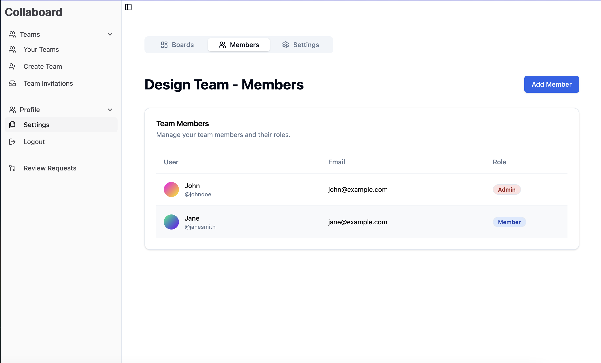
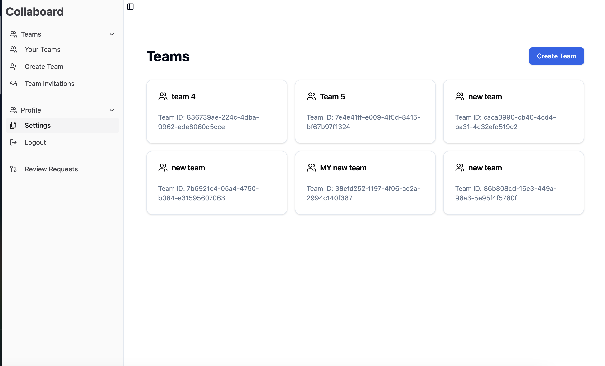
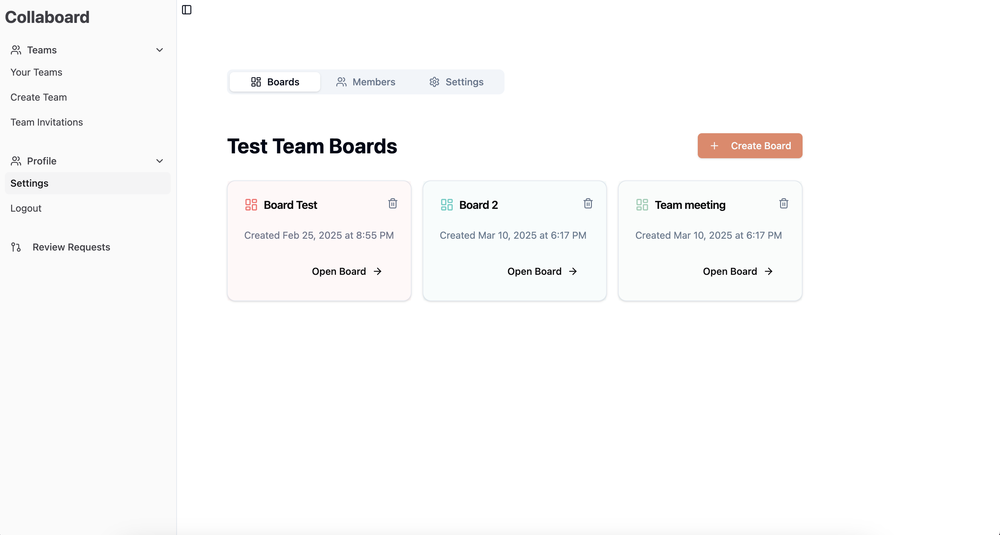
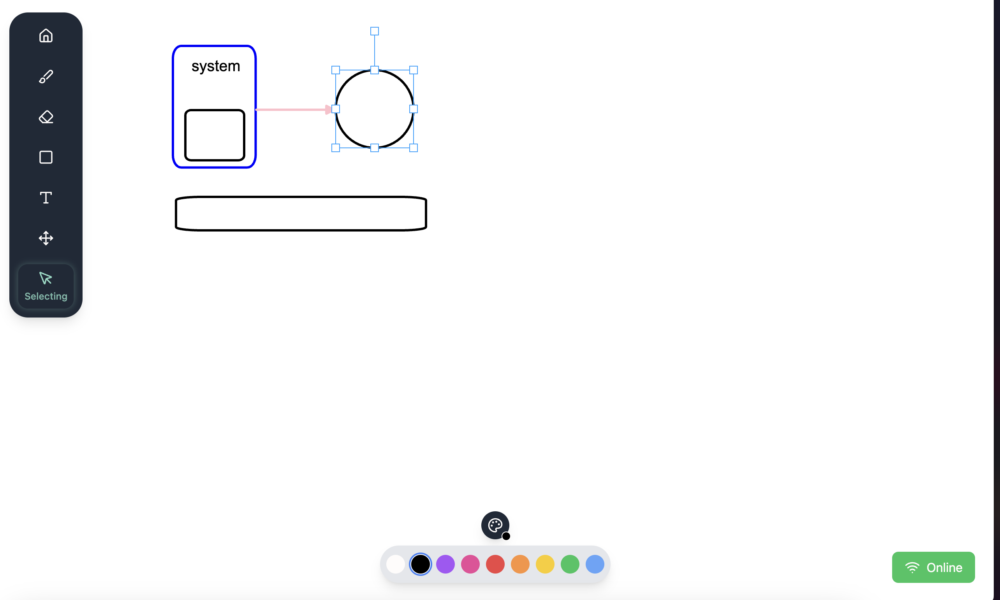
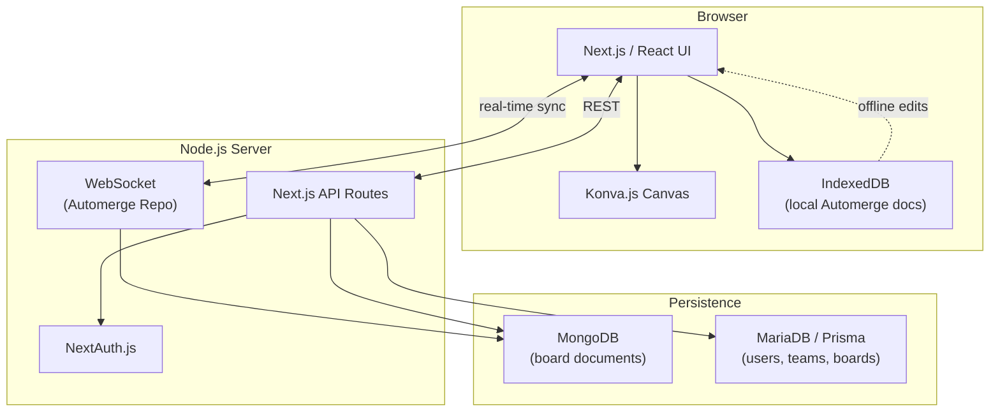

<div align="center">

# Collaboard

### Real-time collaborative whiteboard for distributed teams

**CRDT-powered sync · Offline-first editing · Git-style merge workflow**

<br/>

[](https://youtu.be/4fAZwUMjQqk)
[](https://nextjs.org/)
[](https://www.typescriptlang.org/)
[](https://automerge.org/)
[](https://jestjs.io/)

<br/>

[Features](#-features) · [Quick Start](#-quick-start) · [Architecture](#-architecture) · [Project Structure](#-project-structure)

</div>

---

## Overview

Collaboard is a full-stack collaborative whiteboard where teams sketch, annotate, and iterate together — in real time or completely offline. Board state is synchronized with **CRDTs (Conflict-free Replicated Data Types)** via [Automerge](https://automerge.org/), so concurrent edits merge safely without a central lock.

When users reconnect after working offline, changes flow through a **merge request workflow** with visual diffs and reviewer approval — bringing version-control discipline to canvas collaboration.

> **Built to demonstrate:** distributed systems thinking, real-time UX, offline-first architecture, and production-grade full-stack patterns.

---

## ✨ Features

### 👥 Teams & Access Control

| Capability | Details |
|---|---|
| Authentication | Secure sign-up / sign-in via NextAuth.js |
| Team workspaces | Create teams, invite members, manage roles |
| RBAC | Member and Administrator roles with guarded API routes |

<p align="center">
  
  &nbsp;
  
</p>

### 🎨 Whiteboard Canvas

| Capability | Details |
|---|---|
| Drawing tools | Lines, rectangles, ellipses, freehand strokes |
| Rich objects | Text fields, images, and icons |
| Manipulation | Move, scale, rotate, group, and lock objects |
| Productivity | Undo/redo, per-object comments, PNG export |
| Awareness | Live cursors, active-user list, edit indicators |

<p align="center">
  
  &nbsp;
  
</p>

### 📡 Real-Time Collaboration

- WebSocket transport for live document sync
- Concurrent multi-user editing without conflicts (CRDT-backed)
- Presence indicators showing who is on the board right now
- Per-object edit visualization so teams never step on each other

### 🔌 Offline-First Sync

- Keep editing when the network drops — changes persist locally in IndexedDB
- Automatic reconnection and background synchronization
- **Merge request workflow** for offline edits (request → review → accept/reject)
- Side-by-side visual diff so reviewers see exactly what changed

---

## 🚀 Quick Start

### Prerequisites

- **Node.js** 18+
- **Docker** (for MongoDB & MariaDB)
- **npm**

### Setup

```bash
# 1. Clone the repository
git clone https://github.com/jmacuga/collaboard.git
cd collaboard

# 2. Configure environment
cp .env.example .env
# Fill in AUTH_SECRET, AUTH_URL, and email credentials

# 3. Install dependencies
npm install

# 4. Start databases
docker compose up -d

# 5. Prepare the database
npx prisma generate
npx prisma migrate dev
npx prisma db seed

# 6. Run the development server
npm run dev
```

Open [http://localhost:3000](http://localhost:3000) in your browser.

### Run Tests

```bash
npm test              # unit & integration tests
npm run test:coverage # with coverage report
```

---

## 🏗 Architecture



### Tech Stack

| Layer | Technologies |
|---|---|
| **Frontend** | Next.js 12, React 18, TypeScript |
| **Canvas** | Konva.js, react-konva |
| **Styling** | Tailwind CSS, shadcn/ui, Radix UI |
| **Real-time** | WebSockets, Automerge Repo |
| **Sync engine** | Automerge CRDTs, IndexedDB |
| **Auth** | NextAuth.js, bcrypt |
| **Databases** | MongoDB (document store) · MariaDB + Prisma (relational) |
| **Testing** | Jest, React Testing Library |
| **Infra** | Docker Compose |

---

## 📁 Project Structure

```
collaboard/
├── components/          # React UI organized by feature
│   ├── auth/            # Sign-in, sign-up flows
│   ├── board/           # Canvas, tools, hooks, real-time state
│   ├── boards/          # Board list & navigation
│   ├── merge-requests/  # Offline change review workflow
│   ├── teams/           # Team management & invitations
│   └── ui/              # Shared shadcn components
├── lib/
│   ├── services/        # Business logic (boards, teams, merge requests)
│   ├── auth/            # Authentication helpers
│   ├── sync/            # Presence & network monitoring
│   └── middleware/      # API route guards & error handling
├── pages/               # Next.js pages & API routes
├── prisma/              # Schema, migrations, seed data
├── db/                  # MongoDB models & connection
├── types/               # Shared TypeScript definitions
└── test/                # Unit & integration tests
```

---

<div align="center">

**[▶ Watch the demo on YouTube](https://youtu.be/4fAZwUMjQqk)**

Built with ❤️ by [Julia Macuga](https://github.com/jmacuga)

</div>
